# What Dolphin NG can do

A tour of Dolphin NG, one feature at a time, with how to reach it. For building and installing see
[NG.md](NG.md). All screenshots are of a demo folder.

- [Views: cards and drawn rows](#views-cards-and-drawn-rows)
- [Files drawn, not iconised](#files-drawn-not-iconised)
- [Quick actions](#quick-actions)
- [Work in progress, on the files themselves](#work-in-progress-on-the-files-themselves)
- [Selection](#selection)
- [Pinned to the top](#pinned-to-the-top)
- [Sorting, filters and groups](#sorting-filters-and-groups)
- [Sidebar](#sidebar)
- [Settings](#settings)

## Views: cards and drawn rows

**Cards** are a fourth view mode (Ctrl+4, or the Cards button in the bar above the files). Every item is a
card with its details, in a grid that follows the width of the window. Three looks, picked from the same button:

| Tessera – the picture across the top | Scheda – the picture on the left, compact |
|---|---|
| 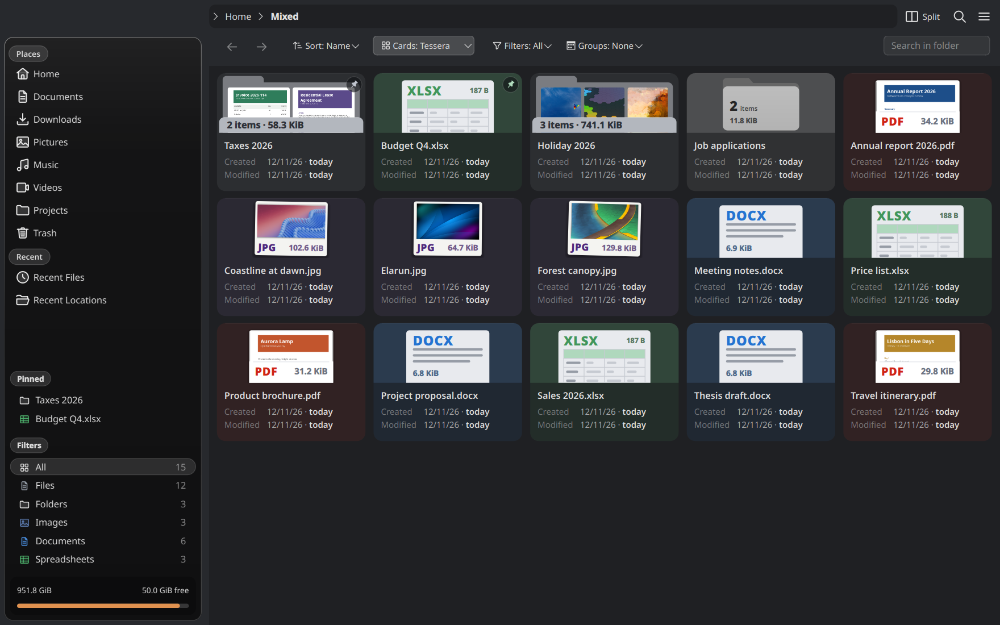 | 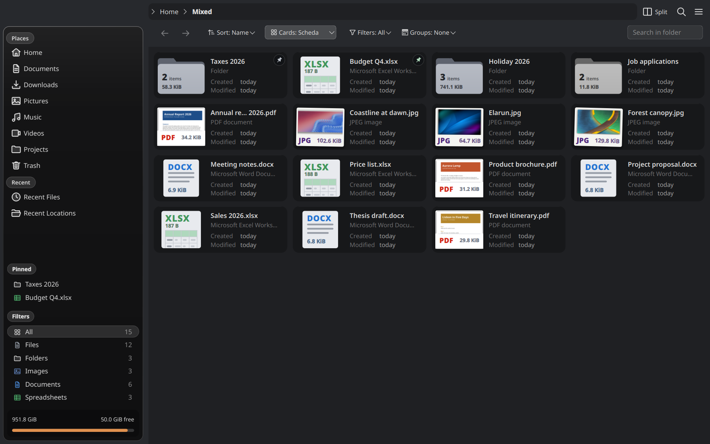 |

**Dossier** is the file's identity card: a header in the colour of its kind, then what is inside the file, three
facts large with their word (pages, words and reading time; size in pixels, when a photo was taken and with what
aperture; duration, resolution and frame rate; files and unpacked size of a ZIP; lines and encoding of a text), where
it came from ("Downloaded from …", the camera, the artist, the author), its tags and rating, and the dates on one
line at the foot. A folder shows a bar of the kinds it holds and the entry changed last. The facts are read in the
background with KFileMetaData (no Baloo needed), only for the cards on screen:

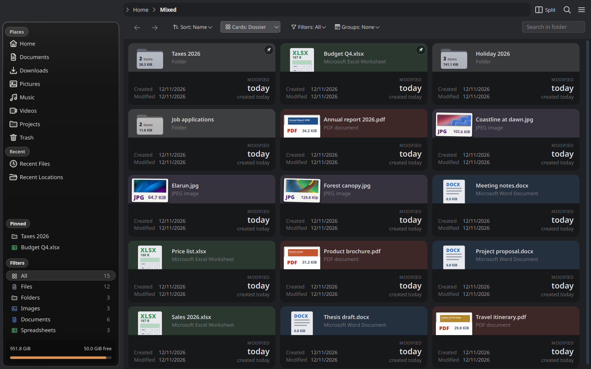

The **details view** becomes two-line **rows**, drawn like the cards: the drawing of the file at the start, the
name and its kind in words, the created and modified dates at the end. There is no column header; the bar above
the files sorts and filters instead.

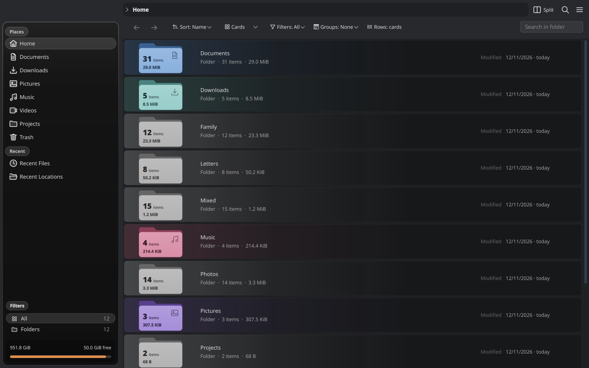

## Files drawn, not iconised

- **Type and size are written into a drawing of the file** instead of a badge: printed on the box of an archive,
  as the title of a page, on the front of a folder.
- **Real previews become objects:** a picture is a print with its white margin (type and size on it), a PDF a
  page with a footer, a video a frame on a strip of film.
- **Folders** are flat folders with their item count, and their size when Dolphin measures folders
  (NG settings → Rows; it keeps the disk busy for a while, and the option says so).
- **The well-known folders of the home** (Desktop, Downloads, Documents, Pictures, Music, Videos, Templates,
  Public, from xdg-user-dirs) are recognised by where they are, with their own colour and sign.

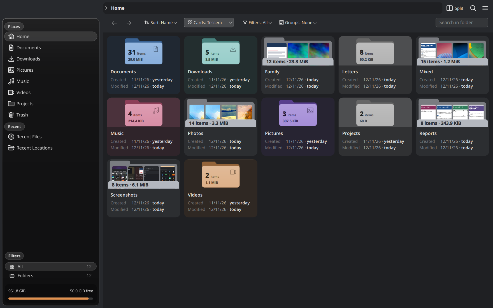

## Quick actions

Hovering a card or a row brings a pill of actions for that kind of file. They run in the background and show
their progress on the file (see below).

| Kind | Actions |
|---|---|
| Images | Resize (75, 50 or 25 %, or to a width of 800, 1280 or 1920 px); an animated GIF to MP4 |
| PDF | To PNG, extract the text |
| Audio | To MP3, to FLAC, transcribe (optional, with a local Whisper model) |
| Video | To MP4, extract the audio, separate audio and video, a frame to PNG, transcribe |
| Archives | Extract here |
| Everything | The next applications for the type, Open with…, cut, copy, pin |

While Ctrl or Shift is held (making a selection) the actions stay hidden and the click selects.

**Your own actions.** Settings → Configure Dolphin → **NG quick actions** lists the kinds of files and their actions:
drag to change the order (the first one shows its name in the pill), untick to switch one off, mark another one as
the main action. *Add* makes an action of your own from a command, from one of the service menus already installed
(the right-click ones) or from an application. A command runs with `sh` in the file's folder, with `{file}`,
`{name}`, `{ext}`, `{dir}` and `{choice}` (an optional small menu, e.g. `75%, 50%, 25%`) quoted for you, inside
quotes or not; what it makes next to the file shows up beside it like the built-in ones. An action can ask before it
runs. Kinds of your own go by extension or type (`*.md`, `text/markdown`). The actions are `.desktop` files in
`~/.config/dolphin-ng/actions`, easy to copy and share.

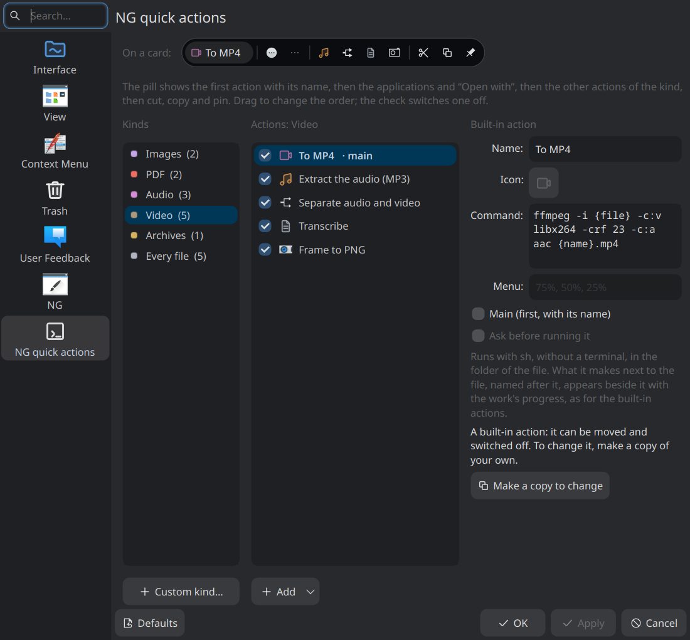

## Work in progress, on the files themselves

A copy, a conversion or a transcription shows on the file it works on: a capsule with the percentage, what is going
on and a stop button. The file it makes appears next to it at once ("On its way…") and the two share a bubble in
the colour of the source until 30 seconds after the work ends. Grouped by date, the new file stays in its
source's group while they are tied. The work also shows in Plasma's job view, and keeps going if Dolphin is
closed.

| Cards | Rows |
|---|---|
| 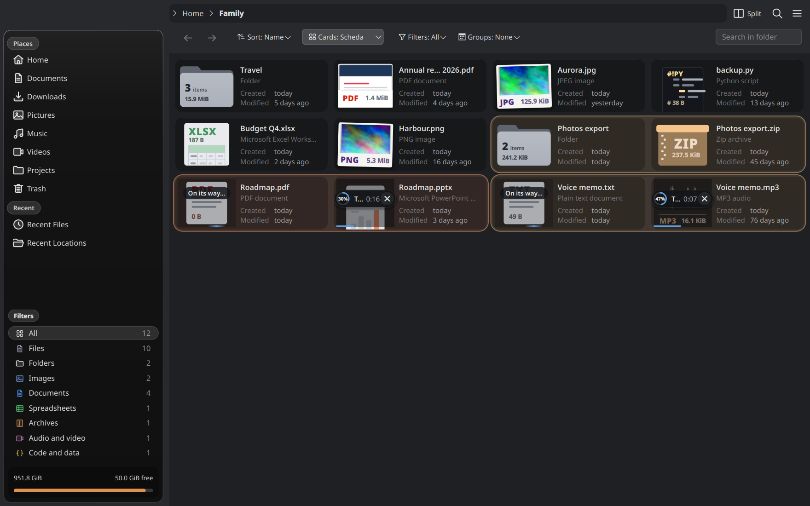 | 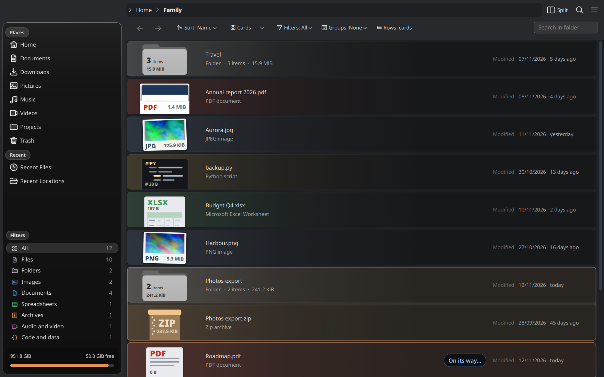 |

## Selection

A selected item gets a ring set off from it, a check at its corner and a light wash of the accent colour. Items
selected next to each other share one outline. Selecting with Ctrl or Shift next to a selection grows the outline
over the new item; a plain click that moves the selection fades instead. Cut files are greyed out and see-through.

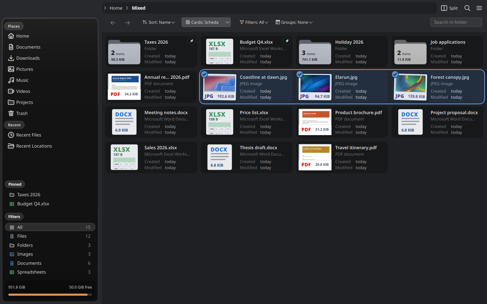

## Pinned to the top

Right-click → **Pin to the Top**, the pushpin button among the quick actions, or Ctrl+Alt+P keeps files and folders
at the top of their folder, whatever the sorting. A small pushpin marks them and the sidebar lists them in a
**Pinned** section, visible in the cards screenshots above. The pin is an extended attribute on the file
(`user.ng.pinned`), so it follows the file when it is moved or renamed.

## Sorting, filters and groups

The bar above the files has, from left to right:

- **Sort** – one button per criterion (click the active one to reverse); a single "Sort: …" button when the window
  is narrow. Sorted by date modified, a folder counts as modified when something inside it was, not only when
  files were added or removed.
- **Cards / view** – switches between views and card looks.
- **Filters** – only files, only folders, or one kind (images, documents, spreadsheets, archives, audio and video,
  code…), each with its count. The same list is in the sidebar.
- **Groups** – none, date modified, date created, type or size; grouping by a date sorts by it too.
- **Search in folder** – narrows the list as you type.

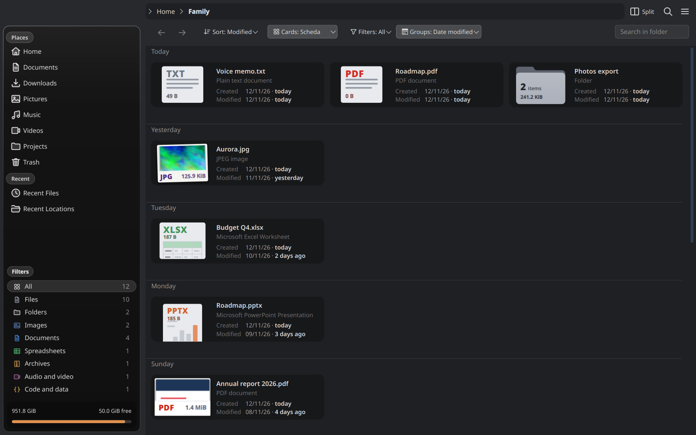

## Sidebar

The places sit on a card of glass that shows the desktop behind it, blurred by the compositor (or a blurred copy
of the wallpaper, or a plain panel). Below them come the **Pinned** items and the **Filters**; at the foot, the
disks: the home one first, then every other disk and partition as a box with its usage (an unmounted one is dashed:
a click mounts and opens it). NG settings → Sidebar chooses between these boxes, the classic **Devices** section or
none, and lists the disks to hide any one of them.

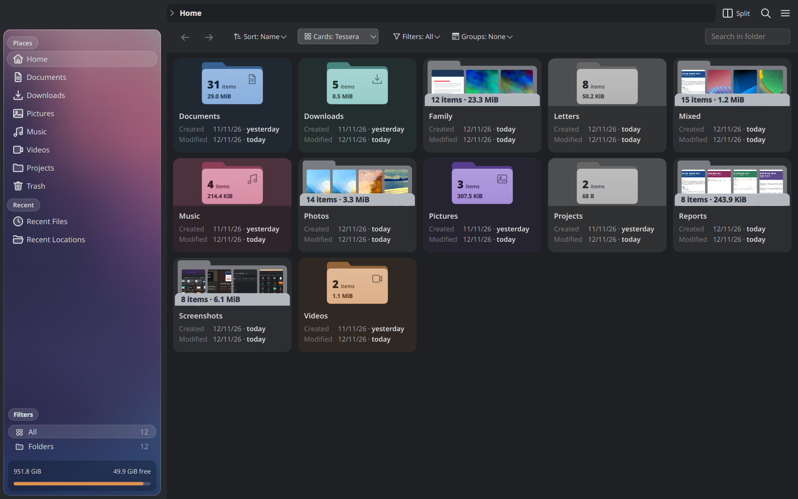

## Settings

Settings → Configure Dolphin → **NG** has everything above as switches and tiles, with a sketch of the window
that follows the choices: three starting looks (Classic, Soft, Glass), then pages for the look, the sidebar, the
rows, the cards and the previews.

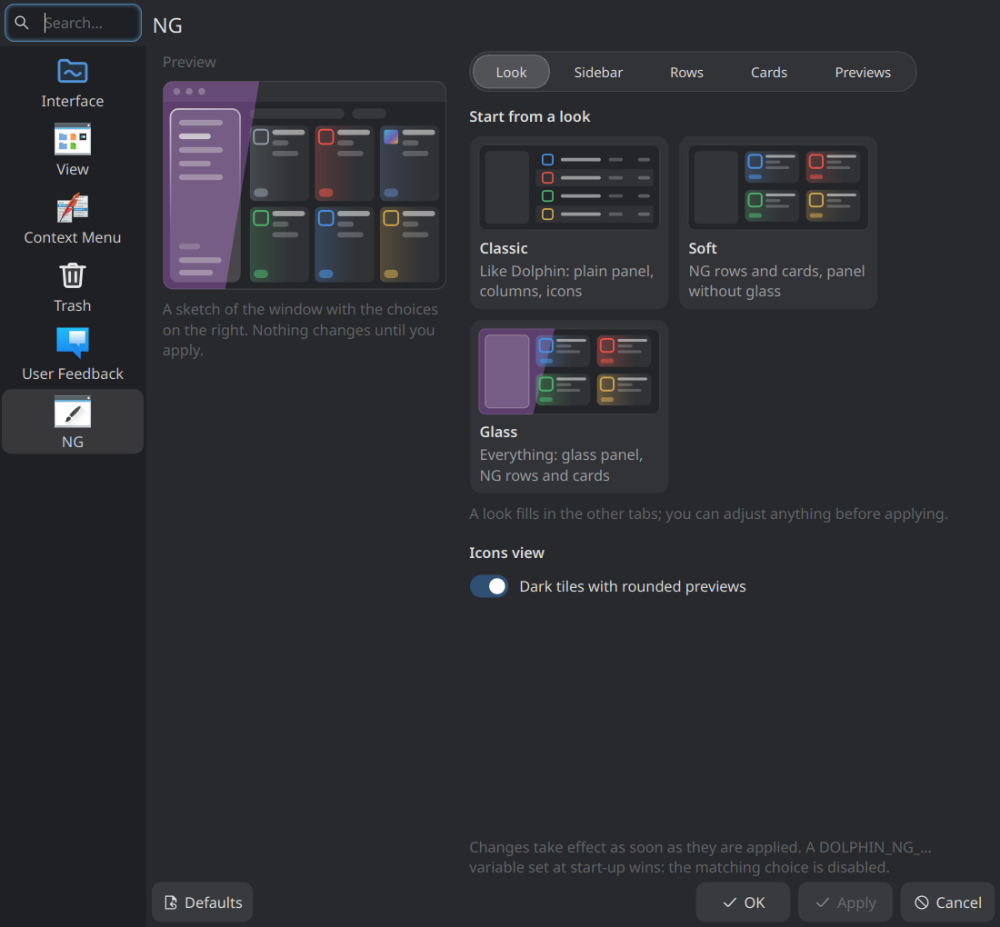
