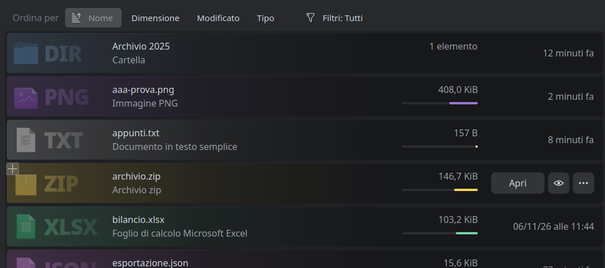
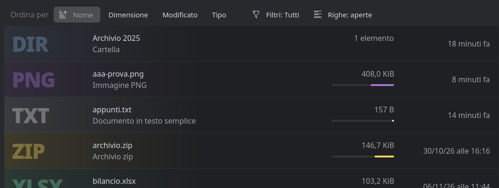
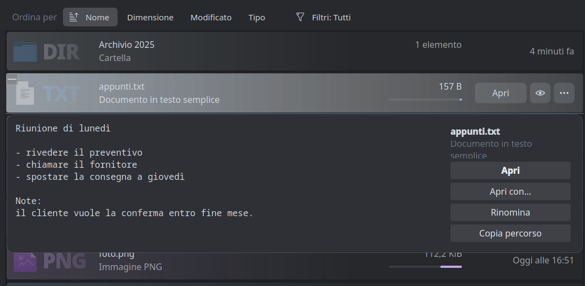
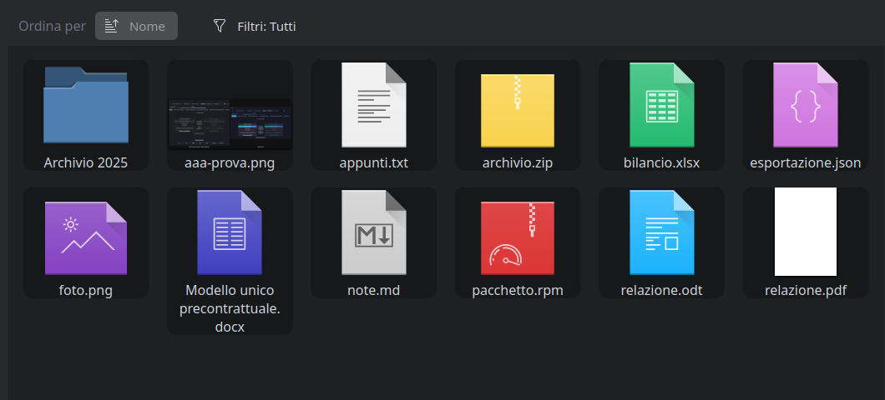

# dolphin-neo

An experimental fork of [Dolphin](https://apps.kde.org/dolphin/), KDE's file manager, that tries a more
modern file list. It is based on Dolphin 26.08.1 and changes only how things are shown and clicked; file
operations are Dolphin's own.

This is a personal experiment, not a KDE project, and it is not meant to replace your distribution's Dolphin:
it installs into your home directory next to it.

| List, cards | List, open rows |
|---|---|
|  |  |

| Preview card | Icons view |
|---|---|
|  |  |

## What is different

**Details view**
- Each item takes two lines: the name, then the other visible columns joined; the date sits at the right edge.
  There is no column header, and rows never get wider than the window.
- No icons. The file type is a large, faint abbreviation at the start of the row, next to a faint type icon,
  and the row is washed with the main colour of that icon.
- The size has its own column with a bar on a logarithmic scale (1 KiB to 10 GiB).
- Hovering a row replaces the date with three buttons: open, preview, and the full context menu.
- The preview is a card under the row: the first lines of text files, the first entries of folders, a thumbnail
  for the rest. Pictures and the first page of PDFs can be zoomed with the wheel and dragged.
- A bar above the list sorts with one click (one button per visible column, click again to reverse), filters
  by kind of file from a menu with counts, and switches between two row styles.
- Narrow windows drop the date first, then the size column.

**Icons view**
- Every item is a dark rounded tile; previews have rounded corners.

**Sidebar**
- Places is a floating "glass" panel. By default it shows a blurred copy of the desktop wallpaper, placed by
  the window's position on screen; optionally the compositor's real blur.
- Section titles are small pills, the internal "Devices" section is replaced by a disk usage box.

**Smaller things**
- A "Root" toolbar action.
- The location bar leaves edit mode when the focus moves to another part of the window.

## Build and run

```sh
sudo dnf builddep dolphin        # Fedora; use your distribution's equivalent
neo/build.sh                     # installs into ~/.local/dolphin-neo
neo/dolphin-neo --new-window
```

Settings are in Dolphin's own settings dialog, on a page called **Neo** (stored in `dolphinrc`, group
`DolphinNeo`). Every setting can also be forced with a `DOLPHIN_NEO_*` environment variable, documented in
[`neo/dolphin-neo.conf.example`](neo/dolphin-neo.conf.example); the launcher reads those from
`~/.config/dolphin-neo.conf`, and a variable that is set wins over the dialog. `neo/dolphinui.rc.example` is a toolbar layout with
the New Folder, Up and Root buttons (copy it to `~/.local/share/kxmlgui5/dolphin/dolphinui.rc`).

## State of things

- Developed and tested on X11 with KWin, Plasma 6, a dark colour scheme and the Kvantum style. Other set-ups,
  Wayland and light themes in particular, are untested. The "live" glass mode uses X11 calls.
- The kind-of-file names in the filter menu and the labels in the preview card are hardcoded in Italian;
  they should go through i18n.
- File kinds and their abbreviations come from the file extension, not from the MIME type.
- The filter menu is skipped in folders with more than 4000 items.
- Most settings on the Neo page are read at start-up; only the sidebar picture and the row style apply at once.
- All changes are marked with `dolphin-neo` comments in the source.

## Contributing

Issues and pull requests are welcome. Good first steps: the i18n of the hardcoded strings, live
settings, Wayland and light-theme testing, and content summaries on the second line (pages, dimensions, row
counts) from KFileMetaData.

## Licence

Like Dolphin: GPL-2.0-or-later. See `LICENSES/`.
