# dolphin-ng

An experimental fork of [Dolphin](https://apps.kde.org/dolphin/), KDE's file manager, that tries a more
modern file list. It is based on Dolphin 26.08.1 and changes only how things are shown and clicked; file
operations are Dolphin's own.

This is a personal experiment, not a KDE project, and it is not meant to replace your distribution's Dolphin:
it installs into your home directory next to it.

| List, cards | List, open rows |
|---|---|
| 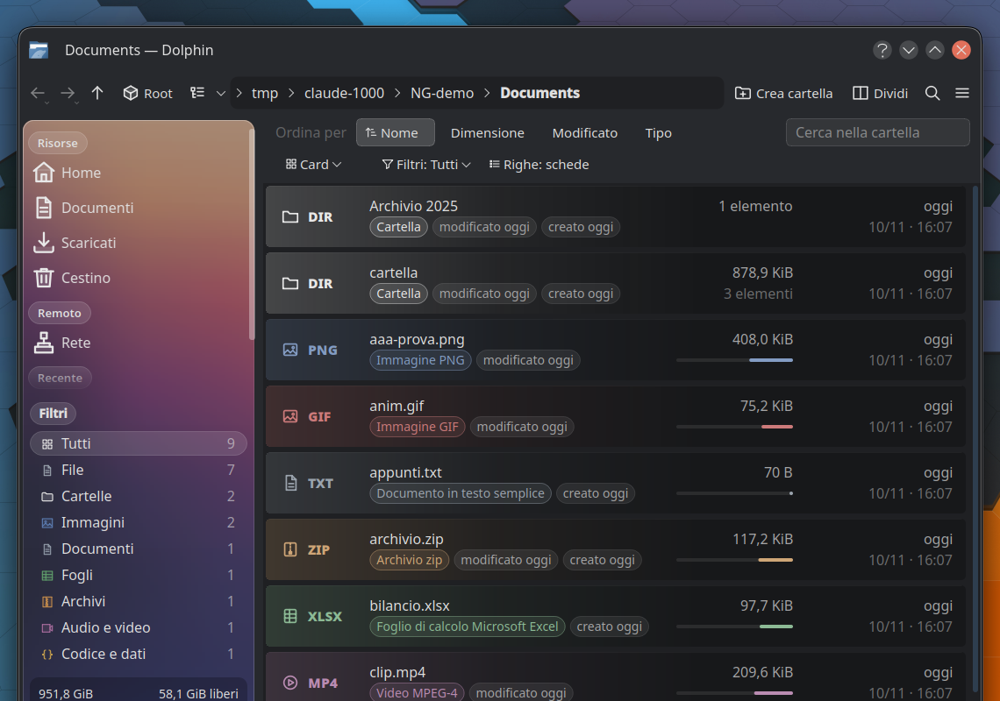 |  |

| Preview card | Icons view |
|---|---|
|  | 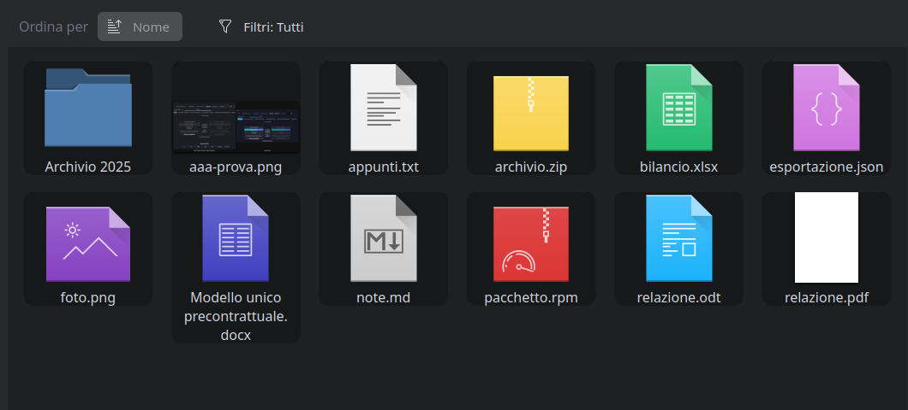 |

## Cards view

A fourth view mode (Ctrl+4, or the "Cards" button in the sort bar): every item is a card with its details, in a
grid that re-flows with the window. Three looks:

- **Tessera** – the preview across the top. A file without a preview gets a sketch of what it holds (a page, a
  table, lines of code, a waveform…), a folder shows its first pictures or lists its first entries. Type and size
  are one badge on the picture; the actions are a pill that fades in on hover.
- **Scheda** – the picture on the left, everything in three lines.
- **Dossier** – the days elapsed, large.

Quick actions by kind of file (resize, extract, convert, open with the next application, cut, copy), a quick view
on hover, a preview card with zoom.

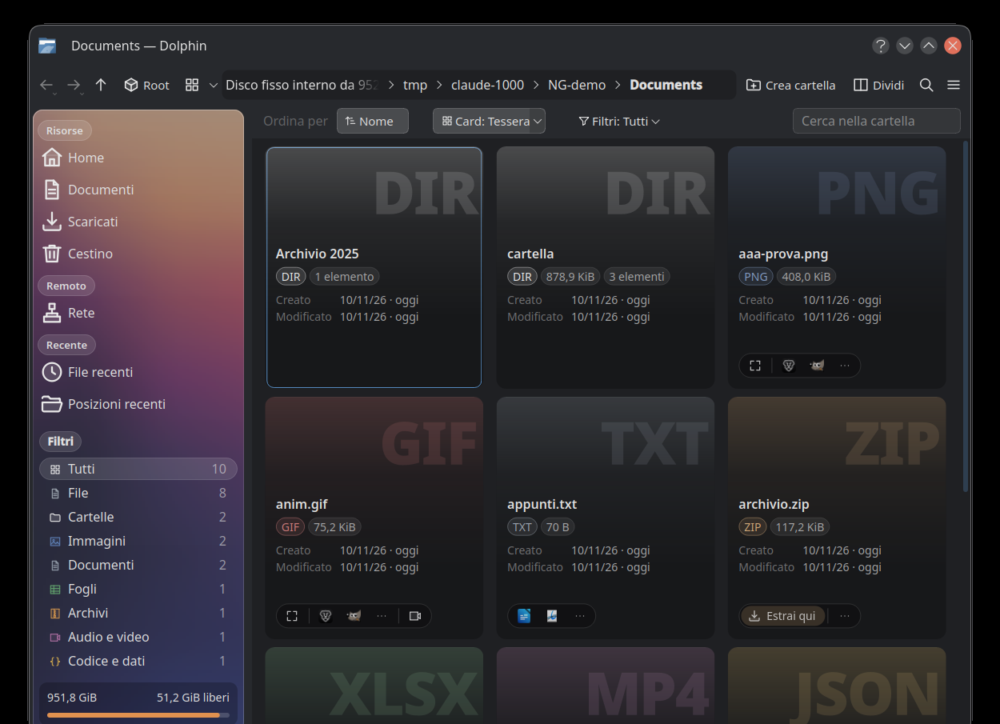

| Scheda | Dossier |
|---|---|
| 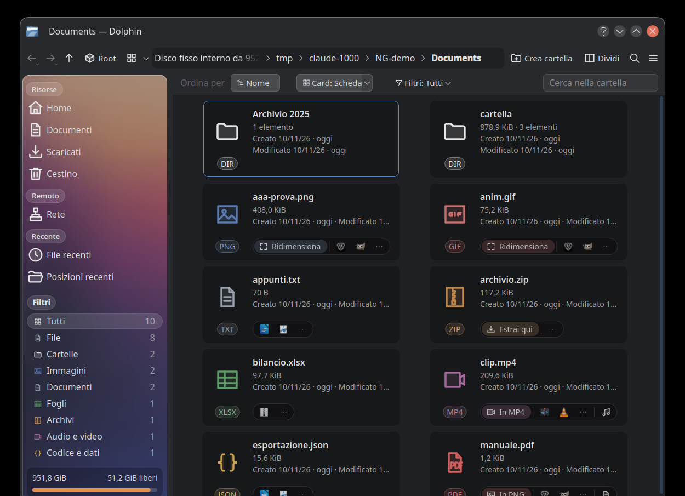 | 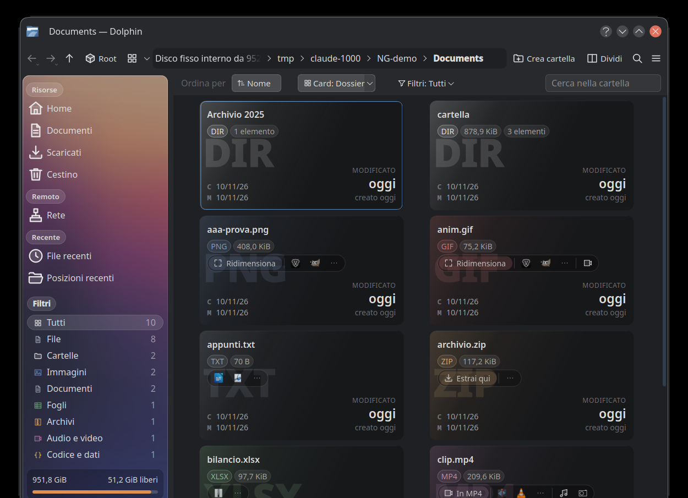 |

## Work in progress, on the files

Copies, moves, deletions and the quick actions show on the file they concern, not only in the notifications:
a ring with the percentage over the card's preview, the row filling up with a caption at its end, a turning arc
while a quick action (extract, convert, transcribe) is running. A first draft: the work started by Dolphin
itself; extractions and downloads started by other applications come next.

| Cards | Rows |
|---|---|
| 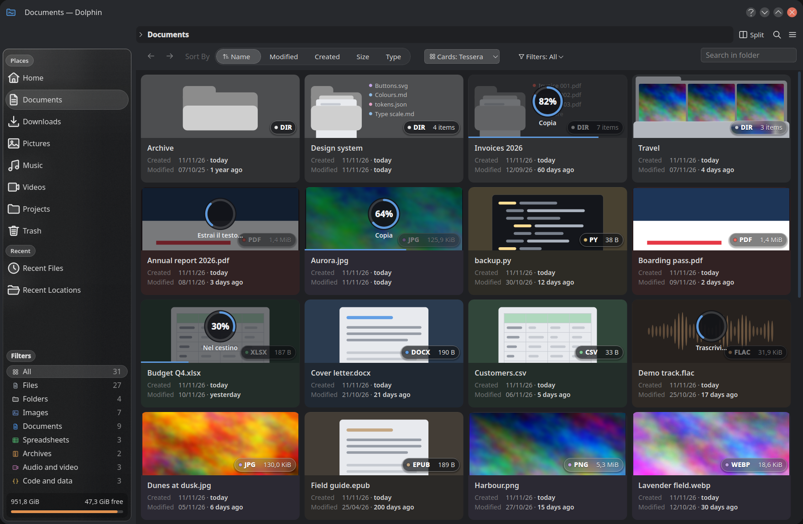 | 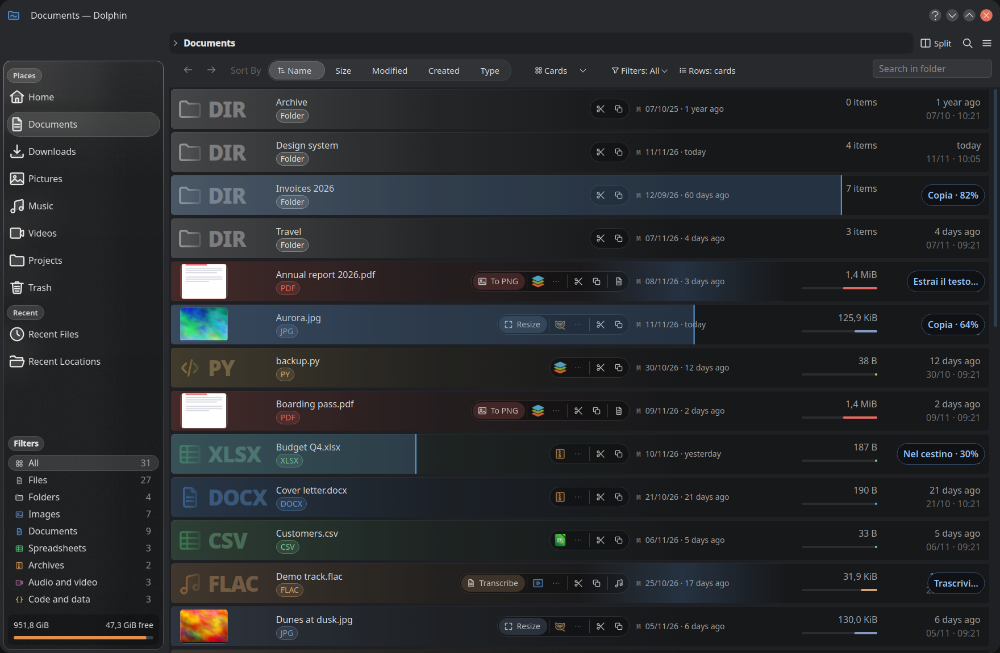 |

A file made from another one (a transcription, an extracted folder, a converted copy, a copy in the same folder)
stands right after it while the work runs, whatever the sort order, and both sit in one tinted bubble: the source
shows the percentage, the new file waits with "On its way…". The bubble goes 30 seconds after the work ends; when the pair wraps to the next row, both pieces stay open towards the edge.
The × next to the caption stops the work. Quick actions run through `ng/ng-job`, which also shows them in Plasma's
notifications (with the percentage and a stop button), so they stay visible, and keep running, when Dolphin NG is
closed; a Dolphin NG opened later shows them on the files again. A program can report its percentage by writing a
number to the file named in `$NG_PROGRESS_FILE`.

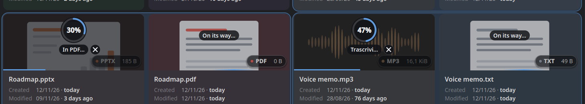

| Cards | Rows |
|---|---|
| 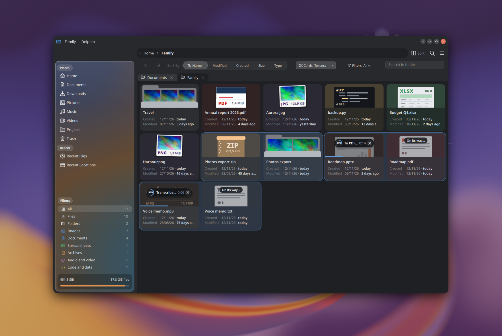 | 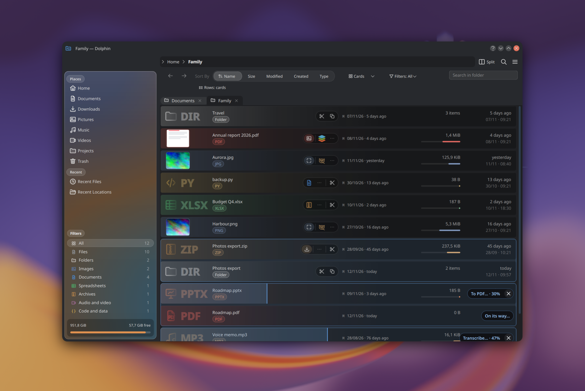 |

**Type and size in the drawing** (Settings > Dolphin NG > Type and size: In the drawing): no badge over the
preview. Where a card shows a drawing of the kind of file, the type and the size are part of it, in its own
colours: printed on the side of the box, as the title of the page with the size as its last line, on the front of
the folder. A real preview becomes the thing itself: a photo is a print with the type and size in its margin, a PDF
a sheet with a footer, a video a frame on a strip of film.

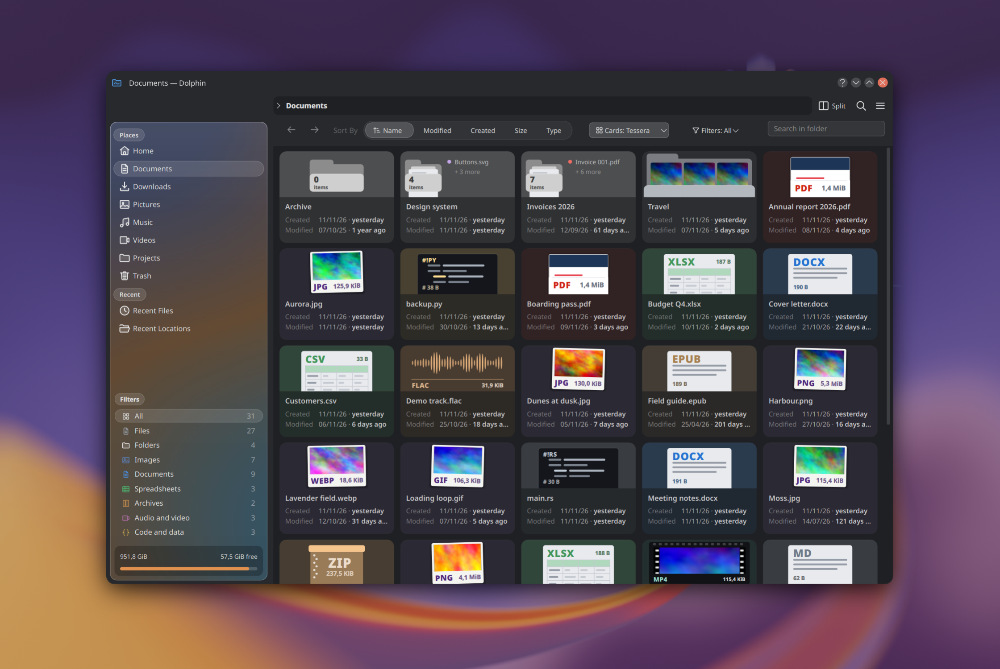

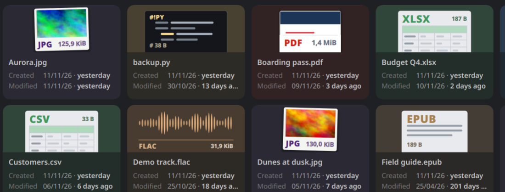

**Transcribe**, on audio and video files, writes the spoken text next to the file (and subtitles for videos), with
[whisper.cpp](https://github.com/ggml-org/whisper.cpp) on your computer: nothing is uploaded. Run
`ng/ng-transcribe --setup` once (it builds whisper.cpp in `~/.local/src` and downloads the speech model, about
550 MB); the action appears when that is done.

## Pinned to the top

The pushpin button in the quick actions, right-click → **Pin to the Top**, or Ctrl+Alt+P on the selection keep files and folders at the top of their
folder, before everything else, whatever the sorting; among themselves they follow the chosen order. A small pushpin in the
colour of the file's type marks them, and their pushpin button is filled. The mark is kept with the file itself, as the extended attribute `user.ng.pinned`, so it
follows the file when it is moved or renamed (it is not kept on file systems without extended attributes, such
as FAT). Right-click → **Unpin from the Top** takes it away.

The sidebar lists them in a **Pinned** section, above the filters: folders first, then files. A folder opens in
the view, a file in its application; right-click offers "Show in its folder" and "Unpin from the Top". The
section can be switched off on the NG settings page (Sidebar → Sections). The list is kept in dolphinrc
(`PinnedPaths`) and fills itself whenever a folder shows a pinned item, so a pinned file that was moved comes
back once its new folder is opened.

## Settings

Everything is a setting, on a graphical page: tabs, a tile with a drawing of each choice, switches, and a sketch of
the window that follows what you pick.

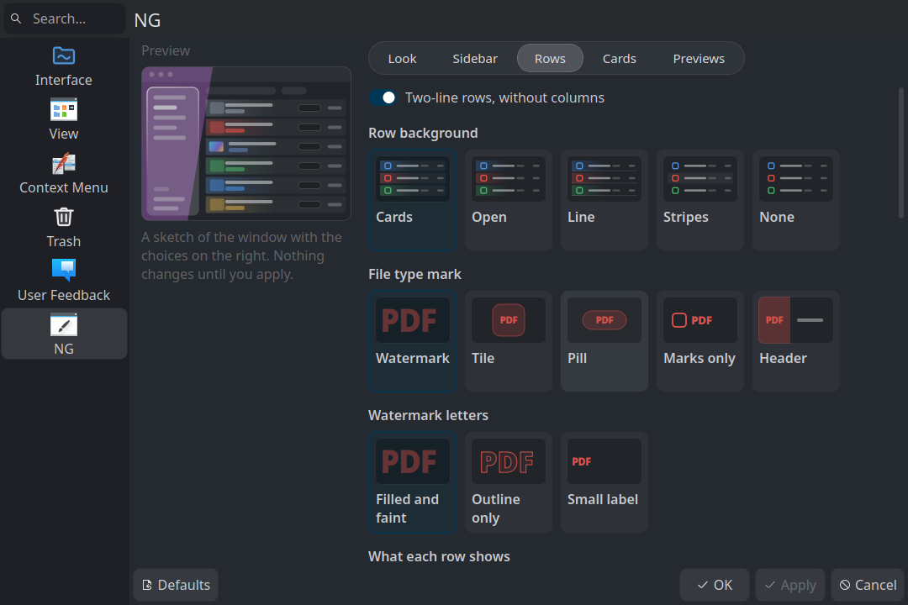

## Glass sidebar

The places panel is a sheet of glass. Its backdrop is a setting: a blurred copy of the wallpaper, an animated
gradient, or the real blur of the desktop behind the window, done by the compositor (below).

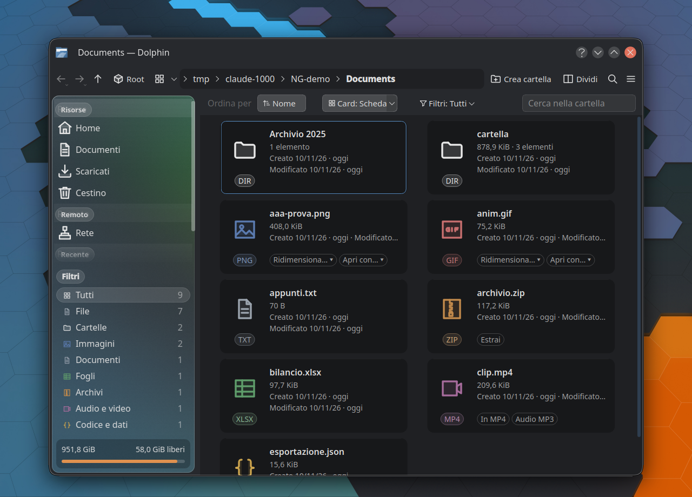

## Part of the NG desktop

- [Breeze NG](https://github.com/Morzilla/breeze-ng) – the widget style and window decoration it was designed with ([KDE Store](https://store.kde.org/p/2381557/))
- [NeoLine](https://github.com/Morzilla/neoline-icons) – the outline icon theme in the screenshots ([KDE Store](https://store.kde.org/p/2381562/))
- Dolphin NG on the KDE Store: https://store.kde.org/p/2381561/

One installer sets up all three. It builds from source, asks which parts you want and which look to start from
(Classic, Soft or Glass), and can switch the desktop to it at the end:

```sh
bash <(curl -fsSL https://raw.githubusercontent.com/Morzilla/breeze-ng/ng/ng/install-gui.sh)      # graphical
bash <(curl -fsSL https://raw.githubusercontent.com/Morzilla/breeze-ng/ng/ng/install-desktop.sh)  # in the terminal
```


The interface of Dolphin NG is in English, and in Italian on an Italian desktop.

## What is different

**Details view**
- Each item takes two lines: the name, then the other visible columns joined; the date sits at the right edge.
  There is no column header, and rows never get wider than the window.
- No icons. By default each row is drawn like a card: at its start the card's drawing of the file, small, with
  the type and size written in it (the folder with its item count, the page with its title, a picture as a
  print, a video on film); the second line says the kind in words, the end of the row the creation and
  modification dates. The quick actions come on hover, the selection is the cards' ring (rows selected next to
  each other share one outline, with a check), and work in progress, families, the pin and cut files look as
  on the cards. The settings keep the older type marks: a large faint abbreviation (watermark), or a line glyph
  with the abbreviation (tile, pill, bare signs, coloured header).
- With the older marks the size has its own column with a bar on a logarithmic scale (1 KiB to 10 GiB).
- Hovering a row replaces the date with three buttons: open, preview, and the full context menu.
- The preview is a card under the row: the first lines of text files, the first entries of folders, a thumbnail
  for the rest. Pictures and the first page of PDFs can be zoomed with the wheel and dragged.
- A bar above the list sorts with one click (one button per visible column, click again to reverse), filters
  by kind of file from a menu with counts, and switches between two row styles.
- Narrow windows drop the date first, then the size column.

**Icons view**
- Every item is a dark rounded tile; previews have rounded corners.

**Sidebar**
- Places is a floating "glass" panel. By default it shows a blurred copy of the desktop wallpaper, placed by
  the window's position on screen; optionally a slow "lava lamp" animation in the wallpaper's colours, or the
  compositor's real blur.
- Section titles are small pills, the internal "Devices" section is replaced by a disk usage box.

**Smaller things**
- A "Root" toolbar action.
- The location bar leaves edit mode when the focus moves to another part of the window.

## Install

One script downloads the source, installs the build dependencies, builds, and installs into your home
directory (`~/.local/dolphin-ng`), next to your distribution's Dolphin:

```sh
curl -fsSL https://raw.githubusercontent.com/Morzilla/dolphin-ng/ng/ng/install.sh | bash
```

or, from a clone, `ng/install.sh`. It adds a "Dolphin NG" entry to the application menu and a `dolphin-ng`
command, and installs the files of the optional [Motto-Neo theme](ng/theme/README.md) without activating it
(`--apply-theme` does that). `--no-deps`, `--no-theme`, `--prefix DIR` and `--uninstall` are the other options.

The script knows dnf (Fedora), apt (Debian, Ubuntu), pacman (Arch) and zypper (openSUSE). Only the Fedora path
has been run, and only without its dependency step; reports and fixes for the others are welcome. The fork is
based on Dolphin 26.08.1, which needs KDE Frameworks 6.23 and Qt 6.4 or newer, so distributions that ship older
ones cannot build it.

To build by hand: install Dolphin's build dependencies, then `ng/build.sh` and `ng/dolphin-ng --new-window`.

Settings are in Dolphin's own settings dialog, on a page called **NG** (stored in `dolphinrc`, group
`DolphinNG`). Every setting can also be forced with a `DOLPHIN_NG_*` environment variable, documented in
[`ng/dolphin-ng.conf.example`](ng/dolphin-ng.conf.example); the launcher reads those from
`~/.config/dolphin-ng.conf`, and a variable that is set wins over the dialog. `ng/dolphinui.rc.example` is a
toolbar layout with the New Folder, Up and Root buttons; the install script puts it in place if you have none.

## State of things

- Developed on X11 with KWin, Plasma 6, a dark colour scheme and the Kvantum style. The fork's own painting
  adapts to light colour schemes (checked once with Breeze Light); Wayland is untested. The "live" glass mode uses X11 calls.
- The kind-of-file names in the filter menu and the labels in the preview card are hardcoded in Italian;
  they should go through i18n.
- File kinds and their abbreviations come from the file extension, not from the MIME type.
- The filter menu is skipped in folders with more than 4000 items.
- Most settings on the NG page are read at start-up; only the sidebar picture and the row style apply at once.
- All changes are marked with `dolphin-ng` comments in the source.

## Contributing

Issues and pull requests are welcome. Good first steps: the i18n of the hardcoded strings, live
settings, Wayland and light-theme testing, and content summaries on the second line (pages, dimensions, row
counts) from KFileMetaData.

## Licence

Like Dolphin: GPL-2.0-or-later, the whole fork, including the scripts in `ng/` (`LICENSE` holds the text). See also `COPYING` and `LICENSES/`. The theme in `ng/theme/` derives from L4ki's Motto themes and is
GPL-3.0; see its README.
