# Dolphin NG

A fork of [Dolphin](https://apps.kde.org/dolphin/), KDE's file manager, that rethinks how users interact with their files: cards
and drawn rows that tell what a file is at a glance, quick filters, groups that follow the sorting, actions one
click away, and work in progress shown on the files themselves. It is based on Dolphin 26.08.1 and changes how
things are shown and clicked; file operations are Dolphin's own. It installs into your home folder, next to your
distribution's Dolphin, and replaces nothing.

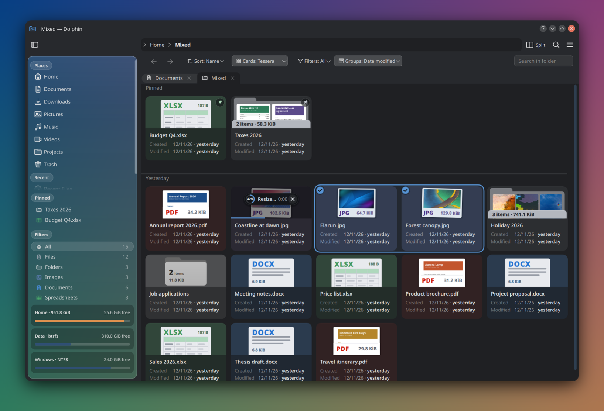

**Try it with the graphical installer: [how it works and how to run it](https://github.com/Morzilla/breeze-ng/blob/ng/NG.md#everything-at-once).**
It sets up Dolphin NG and lets you pick the other parts of the NG desktop (the Breeze NG style, the NeoLine icons,
Dialog NG) and the look to start from:

```sh
bash <(curl -fsSL https://raw.githubusercontent.com/Morzilla/breeze-ng/ng/ng/install-gui.sh)
```

Dolphin NG alone, from the terminal:

```sh
curl -fsSL https://raw.githubusercontent.com/Morzilla/dolphin-ng/ng/ng/install.sh | bash
```

Everything is built from source into your home folder, next to the stock applications; nothing is replaced, and
it can be removed the same way. A longer tour, with every setting: **[FEATURES.md](FEATURES.md)**.

## At a glance

- **[Cards](#cards)**: a view mode of its own, in three looks (Tessera, Scheda, Dossier).
- **[Drawn rows](#drawn-rows)**: the details view without icons: every row carries a drawing of its file.
- **[A bar for sorting, filters and groups](#the-bar)**: one click to sort, filter by kind of file, group.
- **[Groups that follow the sorting](#groups)**: by date, by size (KB, MB, GB, TB), by name, by type.
- **[Work in progress on the files](#work-in-progress-on-the-files)**: copies and conversions show on the file they concern.
- **[Pinned to the top](#pinned-to-the-top)**: files and folders that stay first, whatever the sorting.
- **[Quick actions](#quick-actions)**: resize, convert, extract, transcribe… from the card, and your own commands.
- **[A glass sidebar](#the-sidebar)**: sections in the order you choose, disks with their usage, one button to hide it.
- **[Folder sizes that are remembered](#folder-sizes)**: no recounting every time a folder opens.
- **[The same in every app's file dialog](#dialog-ng)**: Dialog NG, the Open/Save window in this look.

## Cards

A fourth view mode (Ctrl+4, or the Cards button in the bar). Every item is a card with its details, in a grid
that follows the window. A click on the button goes to the next look:

- **Tessera**: the picture on top. A file without a preview gets a drawing of what it holds (a page, a sheet, lines
  of code, a waveform); a folder shows its first pictures, how many items it holds and its size.
- **Scheda**: the picture on the left, everything in three lines; the compact one.
- **Dossier**: the file's identity card: pages and words, size in pixels, duration, where it was downloaded from,
  its tags and rating.

| Tessera | Scheda | Dossier |
|---|---|---|
| 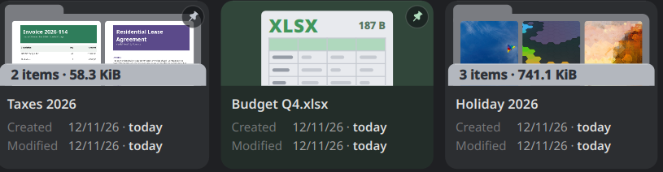 | 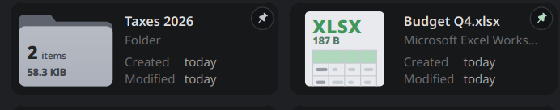 | 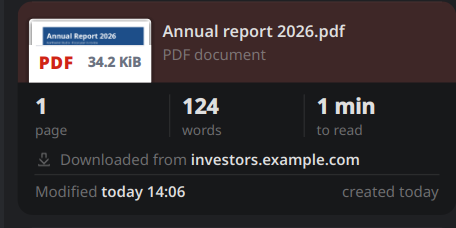 |

Selected cards share one outline, with a check on each:

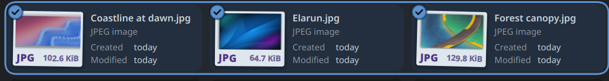

## Drawn rows

The details view without icons and without column headers: each row starts with the card's drawing of its file
(the folder with its item count, the page with its type and size), the second line says the kind in words, and
the end of the row the dates. Narrow windows drop the dates first.

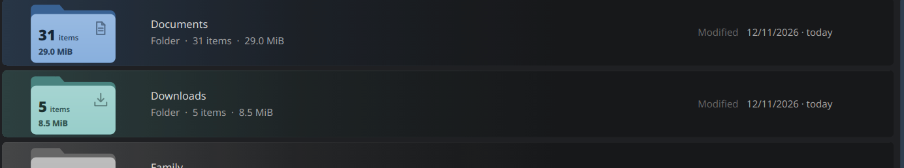

## The bar

Above the files: sort (by name, size, type, date modified or created), the view and its look, the filters by kind
of file with how many there are, and the groups. Each button says the current choice; in a narrow window the
sorting folds into one button.

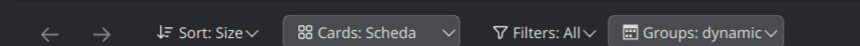

## Groups

Titles between the items, chosen in the Groups menu:

- **Like the sorting (dynamic)**: the groups follow whatever the folder is sorted by: periods by date, letters by
  name, kinds by type, and sizes by order of magnitude: under 1 KB, KB, MB, GB, TB.
- **Folders with the files**: each folder goes to the group of its own size or date, like a file (Dolphin's
  "folders first" is one option away).
- **Pinned**: pinned items have a group of their own, first.

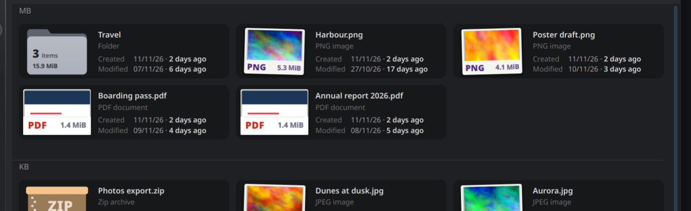

## Work in progress on the files

Copies, moves, deletions and the quick actions show on the file they concern: a ring with the percentage over
the card, the row filling up in the rows view. A file being made from another one (a transcription, an extracted
folder, a converted copy) stands right after it in one tinted bubble while the work runs, "On its way…". Quick
actions also show in Plasma's notifications and keep running when Dolphin NG is closed.

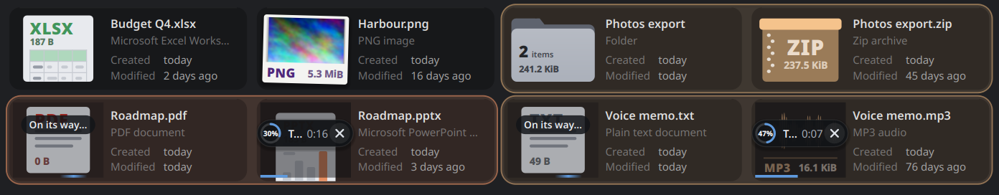

## Pinned to the top

The pushpin in the quick actions, right-click → Pin to the Top, or Ctrl+Alt+P keep files and folders first in
their folder, whatever the sorting. The mark travels with the file (an extended attribute), the sidebar lists the
pinned items, and grouped views give them a group of their own.

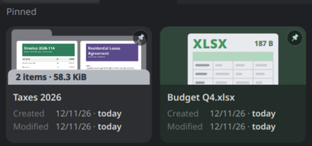

## Quick actions

On hover, a card shows a small pill of actions for its kind of file: resize an image, a GIF to MP4, extract an
archive, a PDF to images or text, transcribe audio and video (with whisper.cpp, on your computer), convert audio
and video, open with the next application, cut, copy, pin. A settings page reorders them, switches them off, and
adds your own: a command (with `{file}`, `{name}`, `{dir}`… and a menu of choices), a KDE service menu, or an
application.

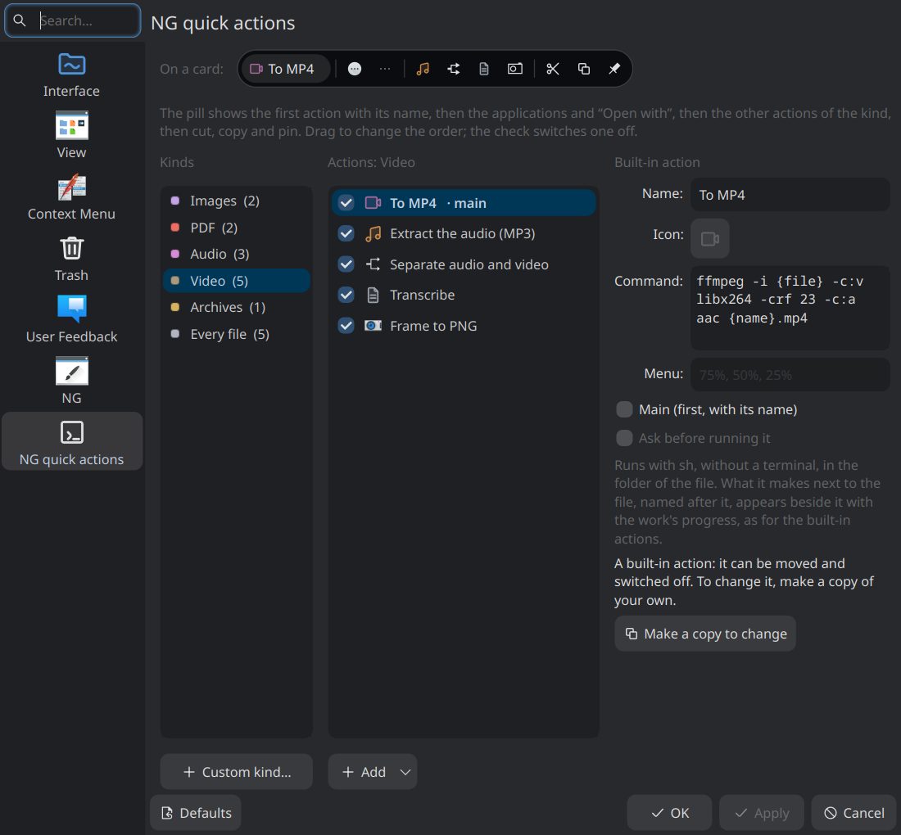

## The sidebar

- **Glass**: the places on a card over the desktop's blur (or a blurred wallpaper, an animated gradient, or a
  plain panel).
- **Sections in any order**: pinned items, filters and disks are dragged into their order in the settings;
  above the places they stay at the top, below them at the foot, and the places scroll in between.
- **Disks**: every disk and partition as a box with its usage; an unmounted one is dashed and a click mounts it.
  The classic Devices section is one setting away, and each disk can be hidden.
- **One button**: the button at the top left of the toolbar hides and shows the whole sidebar (F9 too).

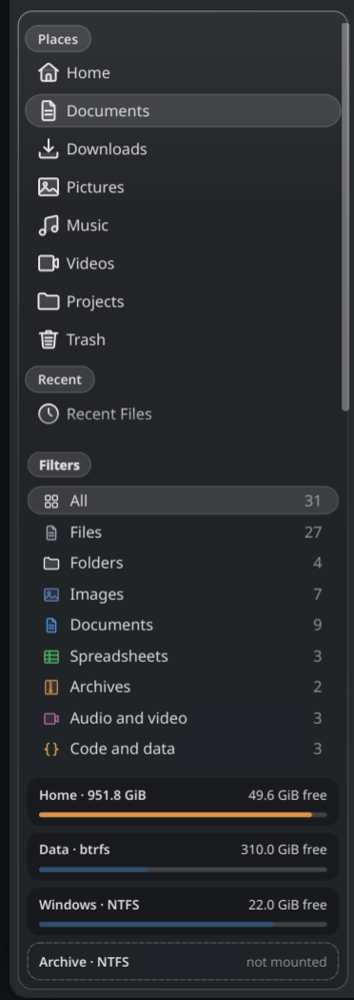

## Folder sizes

When Dolphin shows folder sizes, Dolphin NG keeps them across folders and restarts. A known size shows at once;
it is checked again quietly in the background and only changes if it differs, and copies or deletions made by
KDE applications update the folders above them.

## Dialog NG

[Dialog NG](https://github.com/Morzilla/dialog-ng) gives the Open/Save window of every KDE app (and of Firefox,
Chrome and Flatpak apps through the portal) the same look: the same drawings and rows, a quick preview on hover,
filters with their counts, groups, the items pinned here, and the glass sidebar.


## Install

The easiest way is the **graphical installer** of the NG desktop: pick the parts (Dolphin NG alone, or with the
Breeze NG style, the NeoLine icons and Dialog NG), pick a look, and watch it build. What it does, step by step:
[Breeze NG → Everything at once](https://github.com/Morzilla/breeze-ng/blob/ng/NG.md#everything-at-once).

```sh
bash <(curl -fsSL https://raw.githubusercontent.com/Morzilla/breeze-ng/ng/ng/install-gui.sh)
```

### Dolphin NG alone, from the terminal

The script downloads the source, installs the build dependencies, builds, and installs into
`~/.local/dolphin-ng`, next to your distribution's Dolphin:

```sh
curl -fsSL https://raw.githubusercontent.com/Morzilla/dolphin-ng/ng/ng/install.sh | bash
```

or, from a clone, `ng/install.sh`. It adds a "Dolphin NG" entry to the application menu and a `dolphin-ng`
command. Options: `--no-deps`, `--prefix DIR`, `--uninstall` (and `--no-theme` / `--apply-theme` for the optional
[Motto-Neo theme](ng/theme/README.md)). Running it again updates.

It knows dnf (Fedora), apt (Debian, Ubuntu), pacman (Arch) and zypper (openSUSE), and installs the build
dependencies by name, so no source repositories need to be enabled. Tested from a fresh install, as a normal user
with sudo, in November 2026: Fedora 44, Arch, openSUSE Tumbleweed, Debian sid and Ubuntu 26.10; only Fedora is used
every day. Dolphin 26.08.1 needs KDE Frameworks 6.23 and Qt 6.4 or newer, so older releases (Debian stable,
Ubuntu LTS) cannot build it yet. To build by hand: install Dolphin's build
dependencies, then `ng/build.sh` and `ng/dolphin-ng --new-window`.

## Settings

Everything is on a page called **NG** in Dolphin's settings (look, sidebar, rows, cards, previews), with tiles that
draw each choice and a sketch of the window; three presets (Classic, Soft, Glass) set a whole look at once. The
quick actions have a page of their own. Settings are stored in `dolphinrc` (group `DolphinNG`); any of them can be
forced with a `DOLPHIN_NG_*` variable, see [`ng/dolphin-ng.conf.example`](ng/dolphin-ng.conf.example).

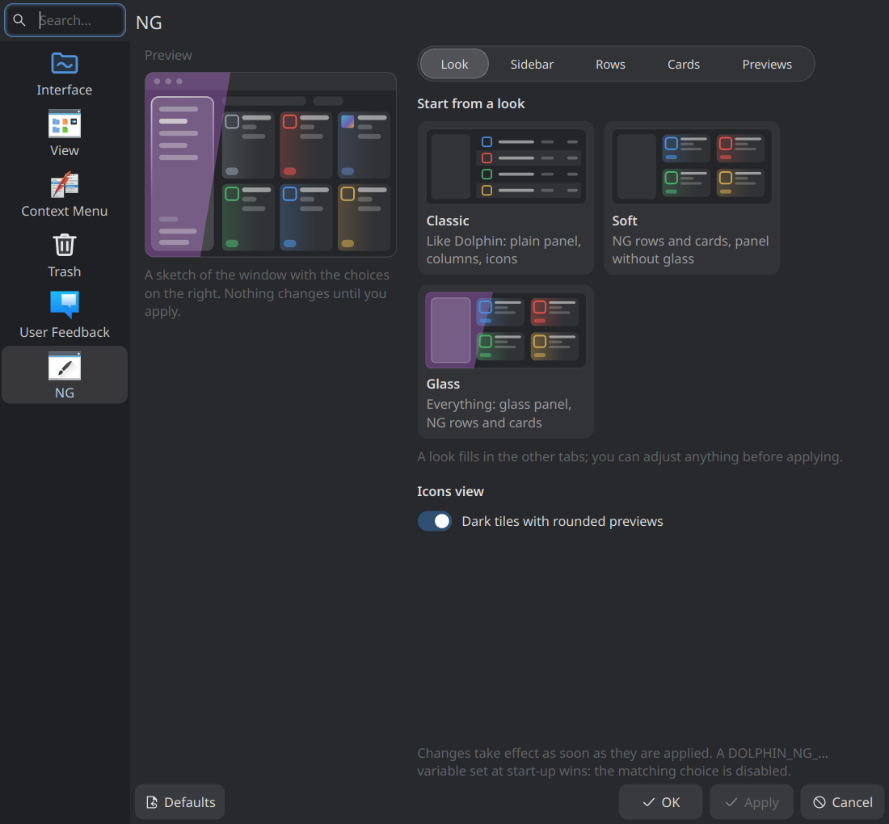

## State of things

- Used every day on Plasma 6.8 (Wayland), on Fedora; it was developed on X11 before that. Dark and light colour
  schemes both work; the "live" glass needs a compositor that blurs (KWin).
- The interface is in English, and in Italian on an Italian desktop; other languages are not translated yet.
- File kinds and their abbreviations come from the file extension, not the MIME type.
- The filter menu is skipped in folders with more than 4000 items.
- All changes are marked with `dolphin-ng` comments in the source.

## Part of the NG desktop

- [Breeze NG](https://github.com/Morzilla/breeze-ng): the widget style and window decoration it was designed with, and the installer ([KDE Store](https://store.kde.org/p/2381557/))
- [NeoLine](https://github.com/Morzilla/neoline-icons): the outline icon theme in the screenshots ([KDE Store](https://store.kde.org/p/2381562/))
- [Dialog NG](https://github.com/Morzilla/dialog-ng): the Open/Save window of every KDE app, in the same look
- Dolphin NG on the KDE Store: https://store.kde.org/p/2381561/

## Contributing

Issues and pull requests are welcome: bugs, ideas, mockups, translations, testing on other distributions.

## Licence

Like Dolphin: GPL-2.0-or-later, the whole fork, including the scripts in `ng/` (`LICENSE` holds the text). See also
`COPYING` and `LICENSES/`. The theme in `ng/theme/` derives from L4ki's Motto themes and is GPL-3.0; see its README.
